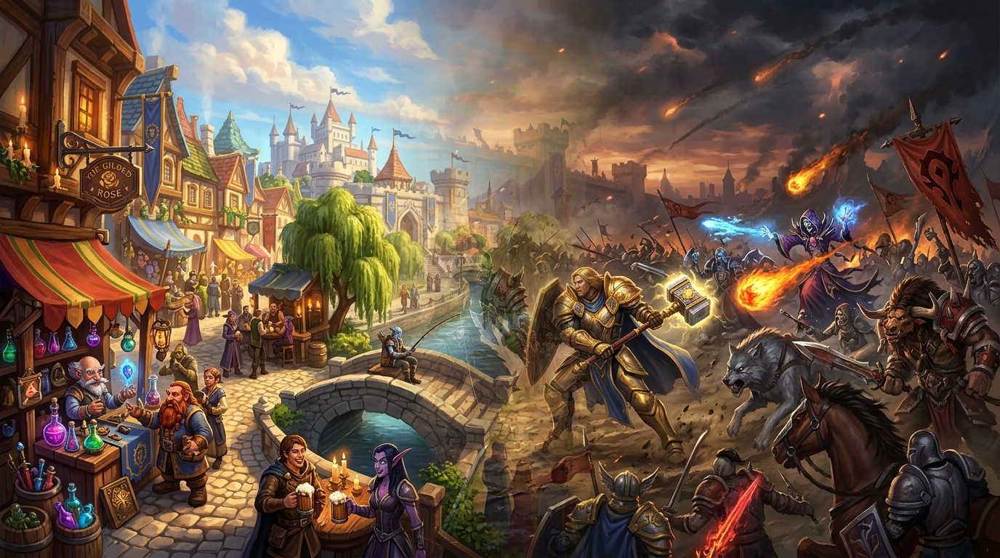

# Cities & Conflicts (`mod-cities-conflicts`)



A unified **AzerothCore** (WotLK 3.3.5a) module bringing cities and the open world to life through autonomous urban simulation, dynamic world PvP conflicts, capital gate duel arenas, and a bundled real-time dashboard client AddOn.

---

## Overview

**Cities & Conflicts** seamlessly merges two essential playerbot ecosystems into a single cohesive runtime:

1. **Living Cities**: Populates capitals, major towns, and social hubs with lively resident bots that explore districts, visit market vendors and class trainers, socialize in taverns, fish along waterways, and carry out realistic idle routines with water-depth avoidance.
2. **World Conflicts**: Orchestrates persistent outdoor faction warfare across 35+ frontline hotspots, reactive capital raid defenses, and vibrant spectator-filled duel arenas outside capital gates with natural approach angles and proximity-based challenger selection.
3. **Mutual Anti-Stealing Protection**: Shared thread-safe reservation registry ensuring citizen bots and combatants never collide or steal leases from one another.
4. **Bundled Client AddOn**: Built-in `CitiesConflictsDashboard` AddOn providing players and GMs with real-time census radars, district occupancy maps, active duel tracking, and bot inspectors.

---

## Requirements

- [AzerothCore WotLK (3.3.5a)](https://github.com/azerothcore/azerothcore-wotlk)
- [mod-playerbots](https://github.com/mod-playerbots/mod-playerbots)

---

## Installation

1. Clone or copy `mod-cities-conflicts` into your `azerothcore-wotlk/modules/` directory:
   ```bash
   cd azerothcore-wotlk/modules
   git clone https://github.com/Ildourol/mod-cities-conflicts.git
   ```
2. Apply the database SQL schemas in `data/sql/manual/` and updates in `data/sql/world/updates/` to your `acore_world` database.
3. Re-run CMake and compile AzerothCore.
4. Copy `conf/mod_cities_conflicts.conf.dist` to `mod_cities_conflicts.conf` in your server config directory and customize as needed.
5. *(Optional)* Copy `addon/CitiesConflictsDashboard` into your World of Warcraft `Interface/AddOns/` directory.

---

## License

This project is licensed under the GNU General Public License v2.
